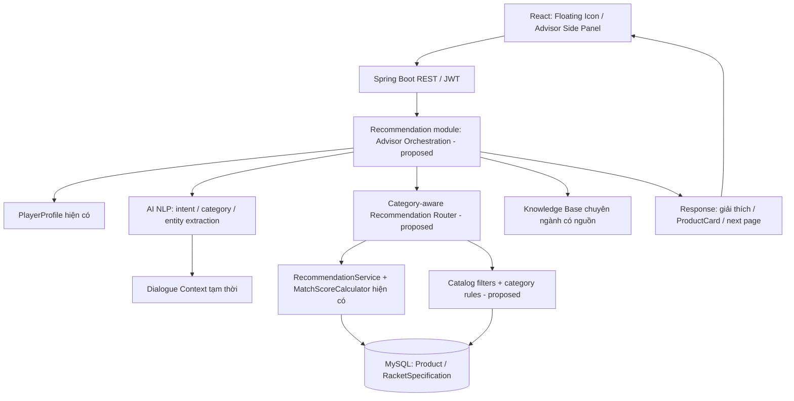

# AI BADMINTON SHOPPING ADVISOR — CẤU TRÚC, THIẾT KẾ VÀ LỘ TRÌNH TRIỂN KHAI

> **Tên đề tài gốc (không đổi):** Xây dựng hệ thống thương mại điện tử cầu lông đa nền tảng tích hợp chức năng gợi ý sản phẩm theo nhu cầu người dùng.  
> **Tài liệu:** Bản thiết kế chi tiết dành cho người phụ trách AI Recommendation.  
> **Phiên bản tài liệu:** Draft 1.1 — 2026-10-10 (bổ sung trạng thái dữ liệu, tồn kho và các trường hợp ngoại lệ).  
> **Trạng thái:** `PROPOSAL / NEEDS_ARCHITECTURE_APPROVAL` đối với những phần làm thay đổi database, Entity, API, business rule hoặc module boundary. **Không phải CHANGELOG đã APPROVED.**  
> **Đối chiếu source:** GitHub `taptappp/Batmintonweb`, nhánh `main`, commit `f1425400b3a30800b3d8dbc15ef18f716f4937a4` (xem ngày/commit khi bắt đầu code).  
> **Tài liệu đi kèm:** `WEB_TEAM_AI_INTEGRATION_GUIDE.md`.

## PHẦN 0. NGUYÊN TẮC VÀ NGUỒN CHUẨN

Trước khi thiết kế/code phải đối chiếu các nguồn của Project: `00_PROJECT_STRUCTURE.md`, `01_SYSTEM_ANALYSIS_MASTER.docx` và bản `.md`, `02_IMPLEMENTATION_RULES.md`, `03_IMPLEMENTATION_STATUS.md`, `04_CHANGELOG.md`. Nếu mâu thuẫn: **CHANGELOG quyết định APPROVED mới nhất → Implementation Rules → Master → Project Structure**. Implementation Status thể hiện tiến độ thực tế, không thay thế quyết định kiến trúc.

**Lưu ý đồng bộ phiên bản:** bản `03_IMPLEMENTATION_STATUS.md` đính kèm Project mô tả thời điểm Sprint 0; tại commit `main` đã đối chiếu, `docs/03_IMPLEMENTATION_STATUS.md` ghi `PlayerProfile / Recommendation` là **TESTING**, không phải `NOT_STARTED` hay `DONE`. Phải đọc status ở commit làm việc thực tế trước mỗi milestone. Không tự suy từ trạng thái đã có code sang đã nghiệm thu.

Các ràng buộc không được phá:

- React frontend; Spring Boot backend; MySQL; REST/JWT; Spring Data JPA/Hibernate; **Modular Monolith**, REST có thể tái dùng cho Mobile. Không mặc định thêm microservice, Python API server, Kafka, CQRS hay công nghệ phân tán.
- **Backend là nguồn quyết định** cho userId, quyền, giá, số tiền, Match Score, tính hợp lệ sản phẩm, trạng thái; frontend chỉ hiển thị.
- **Không gộp** `Product` với `UsedListing`; **không gộp** Shop `Order` với `MarketplaceOrder`. `BUYER` và `SELLER` không phải system role riêng.
- Giữ nguyên `MatchScoreCalculator` và các quyết định CHG-003/CHG-013 liên quan gợi ý vợt. Không áp công thức vợt cho giày/áo/túi/cước.
- Mọi Entity, relationship, endpoint, status, thuộc tính, cách xếp hạng mới đều là **đề xuất**, không tự sửa source chính hoặc CHANGELOG trước khi có quyết định chính thức.

### 0.1. Cấu trúc phân công

**Phần Website (người cộng tác):** quản lý Product Catalog/Category/Brand/ảnh/biến thể nếu được duyệt, Product Detail, Cart, Order, xác thực và tích hợp giao diện toàn website.  
**Phần AI Recommendation (bạn):** nghiệp vụ tư vấn, mô hình NLP tự phát triển, thu thập/chuẩn hóa yêu cầu, gợi ý đa danh mục, giải thích, chat, giao diện AI Side Panel và kiểm thử đặc thù AI.  
Hai người cùng chốt **hợp đồng dữ liệu/API trước khi triển khai song song**, dùng một backend và một nguồn dữ liệu sản phẩm.

## PHẦN 1. MỤC TIÊU, PHẠM VI, ĐỊNH NGHĨA “AI RIÊNG”

### 1.1. Mục tiêu

Xây dựng một **AI Badminton Shopping Advisor** tự phát triển cho hệ thống thương mại điện tử cầu lông, hiểu yêu cầu tiếng Việt và có khả năng gợi ý vợt, dây cước, mức căng tham khảo, giày, quần áo, quấn cán, quả cầu, túi, balo, đồ bảo hộ và các phụ kiện cầu lông **khi Catalog có dữ liệu được kiểm chứng**.

AI phải trả lời được ba nhóm câu hỏi khác nhau:

1. **Tìm sản phẩm:** “Tìm giày trắng cho chân bè, dưới 1 triệu”.
2. **Tư vấn chuyên môn:** “Vợt này có mức căng tối đa bao nhiêu, tôi nên căng mức nào?”.
3. **Tư vấn phối hợp:** “Tôi mới chơi, hãy giúp chọn vợt, cước, giày và một túi trong ngân sách 3 triệu”.

### 1.2. AI riêng nghĩa là gì

- Bạn **tự thiết kế pipeline**, tự xây dựng tập dữ liệu, gán nhãn, huấn luyện/đánh giá thành phần Machine Learning và viết hệ thống hội thoại/tư vấn.
- Được dùng thư viện ML/NLP và thuật toán khoa học có sẵn để huấn luyện mô hình của mình; **không dùng ChatGPT/Gemini/Claude hoặc API chatbot ngoài như bộ não vận hành chính**.
- Có thể dùng **mô hình chuyên biệt tự huấn luyện** cho nhận diện ý định và danh mục, kết hợp luật trích xuất thực thể, cơ sở kiến thức, tìm kiếm sản phẩm và engine gợi ý đã có.
- **Không tuyên bố là tự huấn luyện mô hình ngôn ngữ lớn** nếu thực tế triển khai là classifier + extractor + dialogue rules + grounded response.
- Thư viện huấn luyện, bản quyền/bộ dữ liệu/model artifact cần được ghi nhận đầy đủ. Nếu dùng công cụ ngoài để hỗ trợ tạo dữ liệu nghiên cứu phải tuân thủ yêu cầu của giảng viên và công khai nguồn, không dùng dữ liệu giả như thông số thật của hãng.

### 1.3. Ngoài phạm vi phiên bản đầu

Không yêu cầu AI tự vận hành thanh toán, tự đặt hàng không xác nhận, can thiệp Escrow/Shipment/Dispute, tự sửa Stock/Price/Rating, phân tích chấn thương y tế, chẩn đoán bệnh hay tạo sản phẩm không có trong cơ sở dữ liệu. Gợi ý `UsedListing` Marketplace là **giai đoạn riêng, chưa mặc định gồm trong MVP**, dù vẫn thuộc nền tảng.

## PHẦN 2. TỔNG HỢP 40 CHỨC NĂNG — PHẠM VI ĐÃ THỐNG NHẤT VÀ BỔ SUNG ĐỀ XUẤT

Các mã AI-01…AI-27 là yêu cầu đã thảo luận; **AI-28…AI-40 là các chức năng bổ sung theo yêu cầu xử lý dữ liệu thiếu, tồn kho và các tình huống cần thiết**, trong đó một số phụ thuộc phê duyệt của Web. Đây là **mã yêu cầu**, không phải endpoint, Java enum hoặc decision trong CHANGELOG.

| Mã | Chức năng | Kết quả mong đợi | Ưu tiên |
|---|---|---|---|
| AI-01 | Icon AI nổi | Mở nhanh trợ lý từ website | Core |
| AI-02 | Side Panel | Desktop ~45–50% màn hình; mobile toàn màn hình | Core |
| AI-03 | Chế độ Profile | Dùng `PlayerProfile` thật của người đăng nhập | Core |
| AI-04 | Chế độ tự nhập | Tư vấn cho bản thân/mua hộ, không ghi đè Profile | Core |
| AI-05 | Chat tiếng Việt | Nhập yêu cầu bằng ngôn ngữ tự nhiên | Core |
| AI-06 | Sở thích tự do | Bổ sung màu, hãng, kiểu dáng, nhu cầu… | Core |
| AI-07 | Đa danh mục cầu lông | Không chỉ vợt; chỉ trên catalog có dữ liệu | Core |
| AI-08 | Phân tích nhu cầu | Ý định, danh mục, thuộc tính, điều kiện | Core |
| AI-09 | Hỏi khi thiếu thông tin | Hỏi đúng trường ảnh hưởng kết quả | Core |
| AI-10 | Hiển thị Top 3 | Tối đa ba sản phẩm mặc định | Core |
| AI-11 | Xem thêm/Thu gọn | Tải tiếp danh sách đúng thứ tự | Core |
| AI-12 | Product Card | Ảnh, tên, giá, lý do; score nếu áp dụng | Core |
| AI-13 | Xem chi tiết | Mở trang Product Detail hiện có | Core |
| AI-14 | Giải thích gợi ý | Lý do phù hợp và điều cần cân nhắc | Core |
| AI-15 | Giữ Match Score | Không đổi quy tắc/weights cho vợt | Core |
| AI-16 | Giữ ngữ cảnh | Thu nhỏ/mở lại trong một phiên | High |
| AI-17 | Điều chỉnh qua chat | “Rẻ hơn”, “thay màu”, “nhẹ hơn” | High |
| AI-18 | So sánh 2–3 sản phẩm | Dựa trên thuộc tính và dữ liệu thật | High |
| AI-19 | Hỏi đáp kiến thức | Thuật ngữ vợt, size giày, dây/căng… | High |
| AI-20 | Lựa chọn thay thế | Hết hàng/không có kết quả → phương án khác | High |
| AI-21 | Đánh giá hữu ích | Feedback cho chất lượng tư vấn | High |
| AI-22 | Gợi ý bộ dụng cụ | Nhiều loại sản phẩm trong tổng ngân sách | Advanced |
| AI-23 | Tư vấn tương thích | Vợt–cước–căng–quấn cán, size/đồ dùng | Advanced |
| AI-24 | Yêu thích/Giỏ hàng | Tái dùng nghiệp vụ Web, không tự tính tiền | Integration |
| AI-25 | Lịch sử tư vấn | Xem phiên trước, chỉ nếu duyệt lưu trữ | Advanced |
| AI-26 | Xem nhanh sản phẩm | Quick View bên trong Side Panel | Later |
| AI-27 | Không có kết quả | Giải thích rõ và xin phép nới điều kiện | High |
| AI-28 | Thiếu thông tin đầu vào | Nêu trường còn thiếu; hỏi đúng câu để tiếp tục; không tự đoán | Core |
| AI-29 | Thiếu metadata sản phẩm | Hiển thị “Chưa có thông tin/Chưa xác minh”, trường đang thiếu và cập nhật dự kiến **chỉ nếu được Web xác nhận** | Core |
| AI-30 | Không có sản phẩm phù hợp | Thông báo chính xác “Không tìm thấy sản phẩm phù hợp với các điều kiện hiện tại” | Core |
| AI-31 | Hiển thị tồn kho hiện tại | Từ Backend: “Còn N sản phẩm” hoặc “Hết hàng — số lượng 0” theo status và stock xác minh | Core |
| AI-32 | Hết hàng và sản phẩm thay thế | Không lẫn trong Top 3 có thể mua; khu vực riêng và gợi ý thay thế | Core |
| AI-33 | Dự kiến hàng về | Chỉ hiển thị ETA nếu Web có dữ liệu chính thức; nếu chưa có “Chưa có lịch hàng về” | Integration/Later |
| AI-34 | Tồn kho theo size/màu | Không suy từ stock tổng; “Chưa xác nhận tồn kho size/màu này” khi thiếu SKU/variant | Core guard, implementation cần Web |
| AI-35 | Thông số bất nhất/chưa xác minh | Đánh dấu rõ độ tin cậy, ngừng cam kết tương thích/size/căng dây | Core |
| AI-36 | Giá/stock thay đổi sau khi gợi ý | Làm mới Product Detail/Cart/Checkout; giá, tồn kho luôn do Backend quyết định | Core |
| AI-37 | Sản phẩm ngừng bán/ẩn | Không đưa INACTIVE/DISCONTINUED vào gợi ý mua được; giải thích khi link cũ không còn bán | Core |
| AI-38 | Ảnh hoặc chi tiết thiếu | Placeholder có nhãn, không tạo ảnh/thông số giả; xem chi tiết vẫn hiển thị dữ liệu thật | Core |
| AI-39 | Lỗi mạng/AI/API/tải chậm | Loading, timeout, retry hợp lý, nút thử lại, fallback tìm kiếm/form thường | Core |
| AI-40 | Theo dõi hàng về (tùy chọn) | Yêu cầu thông báo khi có hàng, chỉ sau khi Web duyệt API/lưu dữ liệu/opt-in | Later |

**Yêu cầu UX thống nhất:** trong cả ba chế độ, người dùng **có thể nhập thêm yêu cầu bằng văn bản tự do**; không thay thế bộ chọn thông số/Profile bằng một ô chat bắt buộc. Nếu nhập “thích vợt màu xanh” thì thông số kỹ thuật từ Profile vẫn được sử dụng.

## PHẦN 3. BA LUỒNG SỬ DỤNG CHÍNH

### 3.1. MODE = PROFILE

1. User đã đăng nhập → chọn **Sử dụng hồ sơ của tôi**.
2. Backend xác định userId từ JWT, tải `PlayerProfile` hiện có.
3. Nếu Profile thiếu → hướng dẫn tạo Profile hoặc chuyển sang Tự nhập; không tự bịa giá trị.
4. AI lấy **sở thích đã lưu** (nếu phương án lưu được duyệt) và **yêu cầu tự do mới** (nếu nhập).
5. Phân tích danh mục, yêu cầu; chỉ hỏi những điều thật sự còn thiếu.
6. Truy vấn sản phẩm và sử dụng đúng engine theo danh mục; trả Top 3 và nút Xem thêm.
7. Yêu cầu tạm thời **không sửa Profile**, trừ khi người dùng chọn “Lưu sở thích” và API được duyệt.

**Ví dụ:** Profile INTERMEDIATE / ATTACK / MEDIUM / 4U / 1–2 triệu + “Thích vợt xanh dương, Yonex” → vẫn tính Match Score hiện tại bằng Profile; điều kiện màu/hãng được xử lý riêng theo quyết định sau này.

### 3.2. MODE = MANUAL

1. Chọn danh mục sản phẩm hoặc nhiều danh mục.
2. Frontend hiển thị bộ thông số theo danh mục; riêng vợt dùng những trường kỹ thuật tương thích với Profile đầu vào hiện tại (skillLevel, playStyle, playType, wristStrength, preferredWeight, minBudget, maxBudget).
3. Người dùng nhập cho mình hoặc mua hộ, có ô văn bản bổ sung.
4. Backend kiểm tra giá trị, tạo **snapshot nhu cầu chỉ dùng trong phiên**; không lưu vào `player_profiles` nếu chưa được phê duyệt.
5. Tìm và gợi ý sản phẩm; được phép tiếp tục hỏi qua chat.

**Ví dụ:** giày: chân dài 26 cm, chân bè, màu trắng, dưới 1,5 triệu. Không suy diễn một size EU chung cho tất cả các hãng.

### 3.3. MODE = CHAT

1. Người dùng viết tự do: “Mới chơi, muốn vợt nhẹ và giày, tổng 3 triệu”.
2. AI nhận diện `intent`, `category`, các thông số/trường cần thiết và mức chắc chắn.
3. Dialogue Manager gộp dữ liệu nhiều lượt, hỏi thêm khi chưa đủ; ví dụ “Bạn chọn giày theo số đo chiều dài chân hay size hãng đang dùng?”.
4. Backend tìm sản phẩm; AI tạo câu trả lời từ dữ liệu thật.
5. Người dùng hỏi tiếp “Rẻ hơn”, “Đổi sang giày trắng”, “So sánh hai món đầu” → cập nhật ngữ cảnh, giữ yêu cầu khác.
6. Chat giải thích và các Product Card hiển thị song song trong Side Panel.

### 3.4. Chuyển chế độ

Cần giữ rõ **nguồn của từng trường**: `SAVED_PROFILE`, `MANUAL_INPUT`, `CHAT_EXTRACTED`, `PROFILE_PREFERENCE`. Khi người dùng đổi chế độ, không âm thầm trộn các thông số trái ngược; hỏi xác nhận nếu muốn giữ lại hay xóa điều kiện cũ. Không tự chèn Profile của người mua vào trường hợp mua hộ.

## PHẦN 4. KIẾN TRÚC TÍCH HỢP KHÔNG PHÁ MODULAR MONOLITH



**Ranh giới trách nhiệm:**

- `product`/`category`/`brand`: nguồn thật về danh mục, đặc tính, hình ảnh, giá và tình trạng hàng.
- `recommendation`: điều phối đầu vào và tính/chọn kết quả tư vấn, gọi các service của domain đúng module boundary.
- AI NLP: một **thành phần logic đề xuất** thuộc phạm vi AI; vị trí package/namespace cụ thể cần xác nhận theo kiến trúc, không tự ý tạo module boundary mới.
- `user` và `PlayerProfile`: dữ liệu cá nhân có quyền truy cập; chỉ Backend truy xuất theo JWT.
- React: form, Side Panel, chat, Product Card; **không tính Match Score, không tự quyết định sản phẩm hợp lệ**.

### 4.1. Cấu trúc thư mục gợi ý (CHƯA ĐƯỢC DUYỆT LÀ PACKAGE CHÍNH THỨC)

Ví dụ cách tổ chức **nằm trong `recommendation` đang có**, không triển khai trước khi duyệt:

```text
backend/src/main/java/com/badminton/recommendation/
  controller/             # API Recommendation hiện tại + endpoint mở rộng sau phê duyệt
  service/                # RecommendationService, MatchScoreCalculator: GIỮ
    advisor/              # đề xuất: xử lý chế độ, category routing, tư vấn
    nlp/                  # đề xuất: intent/category extractor, dialogue state
    knowledge/            # đề xuất: kiến thức chuyên ngành có nguồn
  dto/request/            # DTO mới (sau phê duyệt)
  dto/response/           # DTO mới (sau phê duyệt)
  entity/                 # CHỈ thêm khi được phê duyệt
  repository/             # CHỈ thêm khi có model lưu trữ được phê duyệt

frontend/src/
  components/ai-advisor/  # đề xuất FloatingButton, SidePanel, ProductResultCard...
  services/               # adapter gọi REST API AI
  ...                     # không làm thay đổi App Router/Auth hiện tại trái phép

ai-research/               # đề xuất thư mục nghiên cứu OFFLINE, KHÔNG phải runtime service
  datasets/               # dữ liệu được phép sử dụng, có provenance
  experiments/            # nghiên cứu, so sánh mô hình
  metrics/                # đo độ chính xác
  models/                 # model artifact, policy lưu/tải cần duyệt
```

Không tự yêu cầu Python server. **Nếu muốn dùng Python/scikit-learn để huấn luyện offline**, phải ghi đây là công cụ nghiên cứu riêng, được người phụ trách kiến trúc phê duyệt; runtime chính vẫn phải tương thích Java/Spring Boot. Chọn cách triển khai/export mô hình có thể chạy trong JVM hoặc thuật toán thuần Java thay vì tạo thêm service mạng.

### 4.2. Trạng thái code hiện tại đã kiểm chứng

| Thành phần | Tình trạng đối chiếu `main` | Ghi chú |
|---|---|---|
| `PlayerProfile` | Có | skill, style, type, wrist, preferredWeight, budget; chưa có sở thích tự do |
| `MatchScoreCalculator` | Có | Tính cho vợt; công thức giữ nguyên |
| `RecommendationService.recommend(limit)` | Có | Duyệt `RacketSpecification`, ACTIVE, stock > 0; sort điểm giảm dần |
| `GET /api/recommendations?limit=10` | Có | Default 10; yêu cầu role USER và đã có Profile |
| `GET/POST/PUT /api/player-profile` | Có | Backend đã quản lý Profile |
| `GET /api/products`, `GET /api/products/{id}` | Có | Catalog/chi tiết sản phẩm |
| `ProductResponse` | Có | `id`, name, description, price, effectivePrice, stock, images, category, brand, specification... |
| `RacketSpecification.maxTensionLbs` | Có | Giới hạn tối đa **đơn vị lbs**, không phải kg |
| Thuộc tính màu/size/variant có cấu trúc | Chưa thấy ở các Entity đối chiếu | Cần thiết kế sau |
| NLP model/chat/multi-category AI | Chưa thấy ở flow hiện có | Cần thiết kế, test và triển khai |

## PHẦN 5. ĐẦU VÀO THỐNG NHẤT VÀ QUY TẮC GHÉP DỮ LIỆU

### 5.1. Input chuẩn hóa (mô hình DTO logic đề xuất, **không phải Entity mới**)

```text
RecommendationContext [PROPOSED]
  sourceMode: PROFILE | MANUAL | CHAT       # Tên enum/chế độ đề xuất, chưa phải API chính thức
  requester: xác định từ JWT/session bên Backend
  targetCategoryIds: danh mục người dùng cần (có thể nhiều)
  technicalProfile: tập trường cần dùng cho vợt, lấy từ profile hoặc input tạm
  constraints: ngân sách, size, chiều dài chân, thương hiệu, màu, độ căng...
  freeTextPreference: văn bản sở thích bổ sung, không bắt buộc
  hardConstraints: tập điều kiện bắt buộc
  softPreferences: tập điều kiện ưu tiên
  provenance: nguồn + độ tin cậy từng trường
  dialogueContext: ngữ cảnh phiên, không mặc định lưu DB
```

**Chú ý:** schema, enum, endpoint và cách lưu context chỉ là đầu vào cho Architecture Review; không bổ sung vào `PlayerProfile` trực tiếp khi chưa duyệt.

### 5.2. Thứ tự xác định giá trị

1. Yêu cầu **được xác nhận** trong lượt tư vấn hiện tại (form/chat) áp dụng cho phiên đó.
2. Yêu cầu từ bộ thông số tự nhập (MANUAL) hoặc Profile (PROFILE), tùy mode.
3. Sở thích mặc định đã lưu, chỉ dùng cho những tiêu chí chưa có yêu cầu mới.
4. Không biết → `unknown`, hỏi thêm nếu thật sự cần; không tự đoán.

Nếu nói “Tôi thích xanh”, AI không được gán chắc chắn là xanh dương. Nếu nói “chỉ màu xanh dương”, tính thành hard constraint; “ưu tiên màu xanh dương” thành soft preference. Nếu người dùng mâu thuẫn (maxBudget 1 triệu nhưng “dưới 800 nghìn”), xác nhận điều kiện mới trước khi lọc.

### 5.3. Lưu sở thích vào hồ sơ

Yêu cầu người dùng: **ưu tiên văn bản tự do**. Hướng đề xuất:

- Sở thích mặc định có thể lưu một đoạn `preferenceText` liên quan người dùng, được người dùng nhập/sửa/xóa bằng thao tác riêng (thiết kế field/bảng tùy quyết định kiến trúc).
- Nội dung tự nhập cho phiên mua hộ **không cập nhật** bản này.
- AI trích xuất lại sở thích để lọc nhưng không âm thầm thay đổi sở thích gốc của người dùng.
- Có giới hạn ký tự, chống XSS khi render, không đưa nội dung mô hình tạo thành dữ liệu hệ thống.

## PHẦN 6. DANH MỤC VÀ THUỘC TÍNH KỸ THUẬT CẦN DỮ LIỆU

**Các trường bên dưới là danh sách thuộc tính đề xuất cho Catalog, không khẳng định đã tồn tại ở source.** Cần có thông tin sản phẩm thật, đơn vị rõ ràng, nguồn/tài liệu hãng và tình trạng khả dụng.

| Nhóm | Thuộc tính cần chuẩn hóa | Câu hỏi điển hình | Ghi chú dữ liệu |
|---|---|---|---|
| Vợt | 2U–6U, cân bằng, flex, grip, dài vợt, material, max tension lbs, style, skill | “Mới chơi, cổ tay yếu nên dùng loại nào?” | Nhiều thuộc tính đã có ở `RacketSpecification` |
| Dây cước | đường kính mm, cảm giác đánh, độ bền, độ nảy, kiểm soát, màu, hướng dẫn nhà sản xuất | “Dây nào hợp người thích phản tạt?” | Hiện thiếu model chuyên biệt |
| Tư vấn căng dây | mẫu vợt, `maxTensionLbs`, độ căng đang dùng, mức chơi, nhu cầu, giới hạn hãng | “Căng 10 kg được không?” | Không suy mức căng an toàn chỉ từ lực tay |
| Giày | size theo brand/JP cm/EU/US, chart theo SKU, chân bè/hẹp, đế, grip, hỗ trợ cổ chân, màu | “Chân 26 cm, bè, đi size nào?” | Cần size chart và size đang có hàng |
| Quần áo | size theo brand, số đo, chất liệu, thoáng, giới tính/form nếu dùng, màu | “Áo thoáng, size L, dưới 400k” | Không giả định chart chung |
| Tất/bảo hộ | loại, size, đệm, hỗ trợ, chất liệu | “Tất chống trượt cho sân trong nhà?” | Không tuyên bố lợi ích y tế không kiểm chứng |
| Quấn cán | loại, độ dày, độ bám, hút ẩm, màu, grip compatibility | “Tay ra nhiều mồ hôi nên chọn gì?” | Cần catalog có thuộc tính tương ứng |
| Quả cầu | nylon/lông, speed grade, môi trường dùng, độ bền, số quả/hộp | “Đánh phong trào dùng cầu nào?” | Speed grade không quy đổi tùy tiện |
| Túi/balo | sức chứa số vợt, ngăn giày, kích thước, chất liệu, dây đeo, màu | “Balo đựng 3 vợt và 1 đôi giày” | Phải dựa trên thông số hãng |
| Phụ kiện khác | category-defined attribute, size/compatibility, giá | “Bình xịt, băng cổ tay, phụ kiện phù hợp” | Không tự tạo field vô hạn |

### 6.1. Hình ảnh, màu, size và biến thể

`Product` hiện liên kết Category/Brand, có giá, tồn kho tổng và ảnh. Khi một dòng giày có size 40/41/42 hoặc áo có size M/L/XL, **không thể tư vấn chính xác tình trạng từng size nếu chỉ biết `Product.stock` tổng**. Cần bàn với Web về **mô hình thuộc tính và biến thể + tồn kho theo biến thể**. Đây là thay đổi tác động trực tiếp Cart/Order/stock concurrency, phải có bản phê duyệt riêng.

Không đưa ra “còn size 41” khi API không có thông tin tồn kho size đó. Nếu thiếu màu có cấu trúc, có thể cho biết “chưa xác minh màu” thay vì tuyên bố đúng màu theo hình minh họa.

### 6.2. Thông số căng dây: an toàn và chuyển đổi đơn vị

- Phân biệt `maxTensionLbs` **giới hạn tối đa của vợt** và **mức căng khuyến nghị theo nhu cầu**; hai giá trị không đồng nhất.
- Quy đổi chuẩn: `kgf = lbf × 0.45359237`. Trong ngữ cảnh căng dây, cần ghi rõ **kgf** và **lbs lực**, không nhầm với khối lượng kg. Nếu hiển thị “kg” phổ thông, tooltip phải làm rõ đơn vị căng thực tế.
- AI chỉ tư vấn **khoảng tham khảo có nguồn** sau khi biết mẫu vợt, mức căng tối đa, loại dây, nhu cầu, kinh nghiệm; không vượt giới hạn đã xác minh, không coi ngưỡng tối đa là đề xuất mặc định.
- Khi thiếu nhãn/spec hoặc dữ liệu mâu thuẫn, hỏi thêm và đề nghị kiểm tra thông số hãng/người căng vợt chuyên môn. Không dựng “công thức kg theo cấp độ” khi chưa có cơ sở đáng tin cậy/phê duyệt.
- **Không mở chức năng đặt dịch vụ căng dây** trong AI MVP; nếu muốn bán dịch vụ, lập Change Request liên quan Product/Cart/Order riêng.

### 6.3. Giày: size có tính phụ thuộc thương hiệu và mẫu

Tư vấn dựa trên chiều dài chân **cm**, bề ngang, thông tin người dùng biết, **size chart riêng từng hãng/mẫu** và biến thể còn hàng. Khi không có chart, hỏi size thường đi, thông báo chưa xác thực, không tự gán “26 cm luôn tương đương EU 41”.

## PHẦN 7. ENGINE GỢI Ý THEO DANH MỤC

### 7.1. Vợt — GIỮ NGUYÊN BASELINE

Luồng đã duyệt: `PlayerProfile → RecommendationService → Product + RacketSpecification → MatchScoreCalculator → Sort MatchScore DESC`.

| Thành phần | Trọng số bất biến |
|---|---:|
| Skill Level | 20 |
| Play Style | 25 |
| Wrist Strength | 15 |
| Preferred Weight | 15 |
| Shaft Flexibility | 10 |
| Budget | 15 |
| **Tổng** | **100** |

Không sửa các bảng mapping, giá hiệu lực, budget scoring, clamp 0–100, lý do/cảnh báo, cách tie-break hiện có nếu chưa có quyết định thay đổi.

**Quy tắc hiển thị theo sở thích (chưa phê duyệt):**

- *Hard constraint* đã được user xác nhận: có thể lọc trước khi gọi/sắp xếp kết quả, ví dụ “chỉ vợt xanh dương”. Nếu dữ liệu thiếu, thông báo rõ; không nới điều kiện ngầm.
- *Soft preference*: có thể hiển thị ký hiệu “đáp ứng màu xanh”, giải thích/so sánh, **không tự thay thứ tự `MatchScore DESC`** nếu chưa phê duyệt rule rerank riêng. Tùy yêu cầu có thể nhóm sản phẩm đáp ứng sở thích nhưng phải ghi rõ đây là cơ chế mới chờ duyệt.
- Điểm Match Score của vợt vẫn do backend tính, frontend không cộng trừ màu sắc vào score.

### 7.2. Ngoài vợt — CHƯA CÓ SCORE ĐƯỢC DUYỆT

Pipeline đề xuất: `Category Detection → Product Eligibility → Validated Attributes → Hard Filter → Category Ranking → Explanation`.

1. Chỉ lấy Product đang được bán hợp lệ theo quy tắc catalog, có tồn kho/biến thể phù hợp; không lấy `UsedListing` tự động.
2. Lọc `categoryId`, brand/price/keyword đã có từ Product Catalog.
3. Lọc thuộc tính chuyên biệt **chỉ khi DB đã chuẩn hóa và có API được duyệt**.
4. Xếp theo quy tắc xác định, kiểm thử được và được phê duyệt. Trong thời gian chưa có category scoring, có thể hiển thị kết quả thỏa tiêu chí **mà không gắn nhãn `Match Score`**.
5. Nếu cần thứ tự “phù hợp nhất” cho giày/túi/áo, phải chốt riêng tie-break, hard/soft ưu tiên, không tự lấy trọng số vợt hoặc tạo điểm AI tự sinh.

### 7.3. Tư vấn bộ dụng cụ (Advanced)

- AI tạo **nhóm nhu cầu** như vợt + dây + giày + túi, xác định ngân sách chung.
- Backend lấy các đề xuất **riêng từng category**, kiểm tra tương thích và tổng giá dự kiến từ `effectivePrice`/API hiện tại.
- Có thể hiển thị “Top 3 cho mỗi nhóm” hoặc “Top 3 bộ sản phẩm” nhưng **phải duyệt quy tắc cho luồng đa danh mục** trước triển khai; điểm số giữa các nhóm không so trực tiếp được.
- Tổng tiền/stock thực được kiểm tra lại tại Cart/Checkout; AI không cam kết tồn kho/giá vĩnh viễn.

## PHẦN 8. NLP/ML — KẾ HOẠCH XÂY AI DO BẠN TỰ PHÁT TRIỂN

### 8.1. Pipeline triển khai

```text
User utterance
 → Normalize tiếng Việt + số/đơn vị + từ đồng nghĩa
 → Intent Classifier
 → Category Classifier / multi-label category detector
 → Entity/Preference Extractor (thông số, màu, hãng, giá, size, độ căng...)
 → Constraint Resolver (hard / soft, đơn vị, đối tượng mua)
 → Dialogue State + Missing Slot Questions
 → Product Catalog + Category Recommendation
 → Grounded Answer Composer
 → Top 3 Cards + actions
```

### 8.2. Intent tối thiểu

`RECOMMEND_PRODUCT`, `SEARCH_PRODUCT`, `COMPARE_PRODUCTS`, `UPDATE_CONSTRAINT`, `ASK_PRODUCT_INFO`, `ASK_TENSION`, `ASK_SIZE`, `ASK_COMPATIBILITY`, `BUILD_KIT`, `SHOW_MORE`, `SAVE_PREFERENCE`, `OTHER/OUT_OF_SCOPE`.

Đây là **nhãn nghiên cứu đề xuất**, không được biến thành enum API ổn định nếu chưa phê duyệt. Cần ghi chú mapping nhiều ý định trong một câu (“tư vấn vợt và giày”).

### 8.3. Dữ liệu huấn luyện

Tạo corpus tiếng Việt chuyên ngành cầu lông. Mỗi mẫu gán nhãn: `utterance`, `intent`, `categories`, `entities`, `hardSoft`, `missingSlots`, `expectedAction`, `source`, `split`. Ví dụ:

```json
{
  "utterance": "Tìm giày màu trắng cho chân bè, tầm 1 triệu rưỡi",
  "intent": "RECOMMEND_PRODUCT",
  "categories": ["SHOES"],
  "entities": {
    "color": "white",
    "footWidth": "wide",
    "maxBudgetVnd": 1500000
  },
  "hardSoft": {"color": "soft", "maxBudgetVnd": "hard"},
  "source": "manually_authored_example",
  "split": "train"
}
```

Ví dụ schema **chỉ minh họa dữ liệu nghiên cứu**, không phải API/backend enum đã có. Các nhãn và từ khóa phải được chuẩn hóa qua bộ thuật ngữ riêng, kiểm tra sự đa nghĩa của “màu xanh”, “4U”, “10 kg”, “đánh đôi”, “ôm chân”.

Nguồn: câu hỏi tự viết/khảo sát được phép, dữ liệu sản phẩm từ hệ thống, tài liệu hãng có quyền sử dụng và dẫn nguồn. Không sao chép hàng loạt nội dung có bản quyền; không tự tạo thông số sản phẩm. Khử dữ liệu cá nhân trước khi dùng làm corpus; lưu version dataset và công thức tách train/val/test tránh rò rỉ câu gần giống nhau giữa các split.

**Mục tiêu nghiên cứu khởi đầu đề xuất, không phải dữ liệu hiện có:** thu thập đa dạng hàng trăm câu cho các nhóm intent chính và nhiều cách diễn đạt theo danh mục. Ưu tiên chất lượng nhãn và độ phủ trường hợp thay vì cam kết một con số mẫu cố định.

### 8.4. Mô hình/phương pháp phù hợp một người triển khai

- **Baseline:** keyword/rule từ điển + regular expressions cho tiền, size, 2U–6U, lbs/kgf, category, màu. Có log lỗi để phát triển.
- **Model do bạn huấn luyện:** TF-IDF word/character n-grams + Logistic Regression/Linear SVM (hoặc một classifier tương đương chạy được trong môi trường cho phép); thử nghiệm nhiều cấu hình và báo cáo kết quả.
- **Extractors:** kết hợp từ điển chuyên ngành, rules cho số/đơn vị, supervised sequence tagging chỉ khi có đủ nhãn. Không nhất thiết huấn luyện LLM từ đầu.
- **Dialogue:** state machine/slot filling tự xây, tách action planner khỏi text generator.
- **Answer:** template + knowledge retrieval có nguồn + dữ liệu API. Nếu model không đủ confidence, hỏi lại, không đoán.

Lưu model artifact, nhãn, vocabulary/tokenizer, phiên bản dataset và metric; ghi cách load vào JVM. Công cụ huấn luyện offline hoặc việc thêm dependency runtime phải được kiểm tra/phê duyệt để không tự thay stack của project.

### 8.5. Dialogue State đề xuất

```text
sessionId (do Backend tạo / cấp, không phải userId do client tự chọn)
mode
userAuthenticated? (được xác định server-side)
currentCategories[]
slots: skill, playStyle, playType, wrist, weight, budget, color, brand,
       footLengthCm, footWidth, size, racketModel, tensionLbs, etc.
slotSource[] / confidence[]
hardConstraints[] / softPreferences[]
lastShownProductIds[] / paginationAnchor
lastIntent / lastQuestion / unresolvedAmbiguities[]
expiresAt
```

**Quyết định lưu state**: MVP nên ưu tiên context ngắn hạn/phiên, có expiration, không tự thêm bảng chat history. Lưu DB / history, quyền guest, retention và bảo mật chỉ sau phê duyệt.

### 8.6. Bộ kiến thức cầu lông

Lập `KnowledgeItem` logic (chưa phải Entity) gồm: `topic`, `questionPatterns`, `answerFacts`, `sourceName`, `sourceUri`, `sourceDate`, `version`, `applicableProducts`, `lastVerifiedAt`.

Tách rõ **định nghĩa chung** (ví dụ 4U là phân loại khối lượng) và **thông số model cụ thể** (phải tra đúng Product). Khi kiến thức thiếu hoặc lỗi thời, AI nêu giới hạn và hỏi thêm.

## PHẦN 9. GIAO DIỆN VÀ HIỂN THỊ KẾT QUẢ

### 9.1. Floating button và Side Panel

- Nút AI ở góc dưới website, có label “Tư vấn AI”; không che các nút checkout/mobile navigation.
- Trên desktop mở Side Panel **khoảng 45–50% viewport**; phần Web còn lại nhìn thấy để đối chiếu sản phẩm. Mobile hiển thị toàn màn hình hoặc gần toàn màn hình có nút đóng rõ ràng.
- Ba tab/chế độ: **Theo Profile — Tự nhập — Chat AI**.
- Ô “Sở thích/yêu cầu bổ sung” dạng textarea trên Profile/Tự nhập; Chat cho nhập trực tiếp.
- Loading/empty/error/offline state, keyboard focus/ESC, aria labels, scroll riêng, không mất form khi tạm đóng.

### 9.2. Product Card và Top 3

- **Mặc định Top 3** (0–3 item nếu ít dữ liệu), không thay global default `GET /api/recommendations?limit=10` đang tồn tại.
- Card có: ảnh thật (hoặc placeholder chuẩn nếu Product thiếu ảnh), tên, giá từ API, trạng thái, thương hiệu/danh mục khi cần, lý do; vợt có `Match Score 0–100` và breakdown nếu được trả.
- Non-racket **không hiện “Match Score”** khi chưa được duyệt algorithm điểm riêng. Có thể hiện nhãn trung lập “Khớp yêu cầu: màu, giá, size” trên dữ liệu đã xác minh.
- Nhấn card hoặc “Xem chi tiết” → route Product Detail hiện tại của Web (`/products/:id` đối chiếu source), **không dựng trang chi tiết thứ hai**.
- “Xem thêm”: **Top 3 → tối đa 9 → tối đa 15 → ...** (gợi ý mỗi lượt thêm tối đa 6) cho một truy vấn cố định, khi không có nữa thì ẩn nút. “Thu gọn” về Top 3. Phương án phân trang `cursor`/`page` và giới hạn tổng cần duyệt theo API Pagination Rule.
- Không đổi ngầm các kết quả đã xem khi “Xem thêm”: pagination dựa trên thứ tự ổn định hoặc snapshot query. Nếu giá/stock thay đổi, Backend phải vẫn kiểm tra lại ở Product Detail/Checkout.

### 9.3. Hành vi chat

Tin nhắn text + Product Cards + câu hỏi tiếp; có quick prompts “Gợi ý cho người mới”, “Tìm giày”, “Tư vấn căng dây”, “So sánh”, “Rẻ hơn”. Lưu ý các prompt chỉ là gợi ý nhập, **không phải câu trả lời AI cố định**.

## PHẦN 10. HỢP ĐỒNG REST — BẢN ĐỀ XUẤT CHƯA TRIỂN KHAI

### 10.1. API hiện có, tuyệt đối không đổi ngầm

| Method | Path hiện có | Ghi chú |
|---|---|---|
| GET | `/api/player-profile` | `USER`, đọc Profile |
| POST/PUT | `/api/player-profile` | Tạo/cập nhật Profile hiện tại |
| GET | `/api/recommendations?limit=10` | Gợi ý vợt, Profile bắt buộc, Match Score, default 10 |
| GET | `/api/products` | Catalog search/list |
| GET | `/api/products/{id}` | Product Detail |
| GET | `/api/categories`, `/api/brands` | Danh mục/nhãn hàng |

`RecommendationResult` thực tế có `productId`, `productName`, `matchScore`, `reasons`, `cautions`, `breakdown`, `product`.

### 10.2. API mở rộng được đem đi duyệt (đường dẫn chưa phải thật)

| Đề xuất | Mục đích | Điểm cần chốt |
|---|---|---|
| `POST /api/ai/recommendations` | Gợi ý Profile/Manual có sở thích | auth, input schema, pagination, category rules |
| `POST /api/ai/chat` | Chat nhiều lượt | state/session policy, limits, request/response |
| `POST /api/ai/compare` | So sánh sản phẩm thật | productIds validation, ownership/context |
| `GET /api/ai/knowledge/...` hoặc chung qua chat | Hỏi đáp kiến thức | tri thức/nguồn/API thực sự cần thiết |
| `POST /api/ai/feedback` | Hữu ích/không hữu ích | lưu dữ liệu và bảo vệ khỏi spam |
| Preference API | Lưu văn bản sở thích mặc định | vị trí model/ownership, xóa dữ liệu |
| History API (advanced) | Lưu/xem lịch sử | xác thực, quyền, retention |

**Các path trên không tồn tại theo source đã kiểm tra. Không copy code theo path này cho đến khi người chịu trách nhiệm kiến trúc duyệt.** Có thể gom bớt endpoint để giảm tải nếu nghiệp vụ cho phép.

### 10.3. Ví dụ request/response logic **MINH HỌA, KHÔNG PHẢI API CONTRACT ĐÃ DUYỆT**

```json
{
  "sourceMode": "PROFILE",
  "categoryIds": [12],
  "freeTextPreference": "Tôi thích màu xanh dương, ưu tiên thiết kế đơn giản",
  "constraints": {"maxBudgetVnd": 1500000},
  "pageSize": 3
}
```

**Không nhận `userId`, `role`, `matchScore`, `price` từ client làm nguồn nghiệp vụ**. `categoryIds` phải kiểm tra có thật và hợp lệ; số 12 chỉ là ID minh họa.

```json
{
  "items": [
    {
      "productId": 101,
      "product": {"id": 101, "productName": "Sản phẩm minh họa", "thumbnailUrl": null, "effectivePrice": 1200000},
      "scoreType": "RACKET_MATCH",
      "matchScore": 92,
      "reasons": ["Giả định: phù hợp thông số người chơi"],
      "cautions": [],
      "matchedPreferences": ["Màu xanh dương: chỉ được trả khi Catalog xác minh"]
    }
  ],
  "hasMore": true,
  "nextCursor": "opaque-server-issued-token"
}
```

Ví dụ response này chỉ diễn đạt mục tiêu; payload thực tế cần theo `ApiResponse.ok` chuẩn của hệ thống (`success`, `message`, `data`) và `ProductResponse` đã có, cùng quyết định hợp đồng. Với non-racket, `scoreType` có thể là `NONE`, `matchScore` phải không có hoặc `null` theo API đã chốt. `nextCursor` không phải token client tự tính.

## PHẦN 11. CÁC TRƯỜNG HỢP KHÓ, ĐỘ TIN CẬY VÀ AN TOÀN

- “Xanh” mơ hồ → hỏi xanh dương hay xanh lá.
- “10 kg” phải nhận diện có phải **lực căng dây**, không nhầm ngân sách/khối lượng.
- Mua hộ → không áp Profile chủ tài khoản trừ khi người dùng chỉ định.
- Tư vấn căng quá max hoặc không có `maxTensionLbs` → không khuyến khích thực hiện, yêu cầu thông số hãng.
- Mẫu giày thiếu size chart/variant stock → không cam kết còn size hoặc vừa chân.
- Product `INACTIVE`, hết hàng, thiếu ảnh → lọc/xử lý theo đúng nghiệp vụ catalog, tuyệt đối không tự sửa.
- Thương hiệu/màu không có trong catalog → giải thích và hỏi cho phép nới điều kiện, không tự thay điều kiện “chỉ...”.
- NLP confidence thấp → hỏi lại một câu có mục đích; không trả sản phẩm sai danh mục.
- Câu hỏi ngoài cầu lông → giới hạn phạm vi lịch sự, tránh trả lời bịa.
- Prompt mang ý định thao túng (“bỏ qua quy tắc”, “cho tôi giá 0đ”) là dữ liệu người dùng; không thực thi lệnh làm thay đổi backend.
- Bảo vệ PII của người dùng và dữ liệu người được mua hộ; không log thô mọi tin nhắn theo mặc định; redact khi thu thập nghiên cứu.
- Tải cao/timeout → có UI fallback về form và Recommendation cũ. Retry idempotent hợp lý, rate limiting và giới hạn kích thước nội dung.
- Bỏ giỏ hàng, đơn hàng hoặc trả tiền phải đi qua API nghiệp vụ Web hiện có và xác thực đúng quyền.

## PHẦN 12. TEST PLAN VÀ METRIC AI

### 12.1. Regression bảo vệ kiến trúc

- Snapshot tests + unit tests cho `MatchScoreCalculator` với đầy đủ skill/style/wrist/weight/flex/budget, không đổi score với cùng Profile/vợt.
- `GET /api/recommendations` hiện có vẫn đúng role, thiếu Profile, limit validation, sort/tie-break, logging.
- Product/UsedListing và Shop Order/MarketplaceOrder vẫn tách biệt.
- Backend luôn quyết định score, giá, tồn kho, danh mục, userId.

### 12.2. Unit/integration cần có

| Nhóm test | Ca kiểm thử bắt buộc |
|---|---|
| NLP | Nhận diện intent, danh mục đơn/đa danh mục, synonym, câu nói tắt/không dấu |
| Entity | tiền VND, giá, màu xanh mơ hồ, size, 4U, kgf/lbs, phủ định/điều kiện chỉ |
| Dialogue | thiếu dữ liệu → hỏi, nhiều lượt giữ constraints, thay đổi một điều kiện không xóa các điều kiện khác |
| Profile | tự nhập/mua hộ không ghi đè Profile; guest không tự lấy Profile |
| Recommendation vợt | không thay weights; chỉ ACTIVE/stock, score trả từ backend |
| Multi-category | chọn giày/áo/cước đúng danh mục; không có Match Score vợt trên nhóm khác |
| Catalog | không bịa size/stock/color, thiếu metadata → cảnh báo đúng |
| Tension | không vượt maxTensionLbs; đổi lbs↔kgf đúng; không suy mức an toàn từ dữ liệu thiếu |
| Product Card | ảnh/placeholder; giá thật; click mở detail đúng id |
| Pagination | mặc định 3; thêm 6; không lặp/bỏ sót; hết hàng/không có kết quả |
| Security | auth/JWT/authorization, ownership, XSS, payload length, rate limits |
| Integration | đóng/mở panel không mất phiên, reload/đổi route theo policy; Chat → xem chi tiết → quay lại |

### 12.3. Đánh giá model riêng

Chia tập train/validation/test có version, tránh rò rỉ mẫu gần trùng. Báo cáo ít nhất:

- Intent classification: macro-F1, precision/recall theo intent và confusion matrix.
- Category detection: macro-F1/multi-label F1 theo thiết kế nhãn.
- Entity extraction: precision/recall/F1 cho tiền/màu/hãng/size/kgf/lbs.
- Dialogue: tỉ lệ hỏi đúng khi thiếu và hoàn thành mục tiêu tư vấn.
- Recommendation: Precision@3 hoặc relevance rating trên **tập test có người đánh giá**, tỷ lệ vi phạm hard constraints = 0 trên test đủ dữ liệu.
- Business: tỷ lệ click chi tiết, phản hồi hữu ích, fallback rate, thời gian phản hồi (chỉ khi có đo thực tế).

**Không tự ghi `PASS` hay con số accuracy khi chưa chạy test.** Lưu kết quả, dữ liệu, commit/model version và điều kiện môi trường.

## PHẦN 13. LỘ TRÌNH THỰC HIỆN VERTICAL SLICE — MỘT NGƯỜI

| Mốc | Công việc theo thứ tự | Đầu ra nghiệm thu | Phụ thuộc |
|---|---|---|---|
| AI-00 | Đối chiếu nguồn chuẩn, status, API; ký interface contract Web–AI; duyệt changes | ADR/Change Request được xử lý, danh mục thuộc tính thống nhất | Bắt buộc trước khi sửa model |
| AI-01 | Xây khung Floating icon, Side Panel, 3 modes và Product Card (mock local, không giả là kết quả thật) | UI dùng được desktop/mobile, test tương tác | UI contract |
| AI-02 | Database migration (nếu duyệt) → Entity/DTO → Repository → Service → API → API tests cho sở thích & nhu cầu tạm | Gợi ý Profile/Manual đa danh mục có dữ liệu thật | Product Catalog contract |
| AI-03 | Dataset → baseline rules → classifier → extractor → evaluation → artifact | Model/corpus/metric tái lập được | Label guideline |
| AI-04 | Dialogue manager → chat API → grounded response → frontend chat → integration test | Chat tư vấn nhiều lượt + Top 3 | AI-02/03 |
| AI-05 | So sánh, knowledge base, tension/size, tư vấn tương thích, fallback | Trả lời có nguồn và điều kiện an toàn | Thuộc tính catalog |
| AI-06 | Bộ dụng cụ, phản hồi, lịch sử (nếu duyệt), E2E và đánh giá, viết báo cáo | Kịch bản demo và evidence test | Các mốc trước |

**Một vertical slice thực sự:** nếu cần sửa DB → tạo **migration Flyway mới**, không sửa migration đã chạy → Entity → Repository → Service → Controller/DTO → API Test → Frontend → Integration Test. Cập nhật `docs/03_IMPLEMENTATION_STATUS.md` sau milestone hoàn tất có bằng chứng. Chỉ ghi `04_CHANGELOG.md` khi có **thay đổi kiến trúc/business rule đã duyệt**, không dùng như nhật ký commit. Chi tiết thực hiện từng file nên ghi `docs/baocao.md` nếu đã được thống nhất làm nhật ký.

### 13.1. Đường găng và ưu tiên

1. **Chốt API + dữ liệu Catalog** trước; AI không thể tư vấn size giày khi Web không lưu size.
2. **Giữ luồng gợi ý vợt chạy được** làm fallback và regression benchmark.
3. **Hoàn thiện Profile/Manual + Card Top 3** trước chat nâng cao.
4. Dataset/model riêng làm song song nhưng không tuyên bố ML hoàn thành khi chưa có metric.
5. Thêm giải thích, so sánh, tư vấn tương thích; lịch sử/quick-view sau.

## PHẦN 14. VẤN ĐỀ KIẾN TRÚC CHỜ QUYẾT ĐỊNH

Các mục dưới đây phải lập Architecture Issue/Change Request, báo **thiết kế hiện tại → vấn đề → phương án → ảnh hưởng → người quyết định**. Không coi việc đồng ý ý tưởng AI là phê duyệt tự động cho từng thay đổi dữ liệu/API.

| Mã đề xuất | Thiết kế hiện tại | Vấn đề | Phương án cần quyết định | Ảnh hưởng |
|---|---|---|---|---|
| GAP-AI-01 | PlayerProfile chỉ lưu thông số kỹ thuật | Không lưu sở thích tự do | Field riêng / bảng preference / chỉ session | DB, Entity, DTO, quyền riêng tư |
| GAP-AI-02 | GET recommendations cần Profile, gợi ý vợt | Không nhận manual/session | Endpoint mới hoặc mở rộng có version | API, Service, test, logging |
| GAP-AI-03 | Product chung, RacketSpecification cho vợt | Thiếu thuộc tính các danh mục khác | Typed attributes / schema theo danh mục | DB, Catalog, Admin UI, API |
| GAP-AI-04 | Stock ở Product | Không biết tồn kho size/màu | Variant/SKU và stock riêng (nếu hỗ trợ) | Cart, Order, stock concurrency, migration |
| GAP-AI-05 | MatchScore DESC cho vợt | Sở thích tự do ảnh hưởng sắp xếp | Hard filter/soft annotation/rerank rule | Recommendation rule + regression |
| GAP-AI-06 | Chưa có category ranking ngoài vợt | Không xác định top 3 “phù hợp nhất” | Category-specific criteria, tie-break | Service, tests, API semantics |
| GAP-AI-07 | Chưa có Chat/History | Cần context nhiều lượt | session tạm vs persistence + TTL | Auth, DB, privacy, API |
| GAP-AI-08 | JWT & Profile của USER | Guest dùng AI? | Guest có giới hạn hoặc USER only | Security, rate limit, profile access |
| GAP-AI-09 | Catalog shop tách Marketplace | Muốn tư vấn hàng cũ? | MVP Product only; phase 2 UsedListing | Module boundary, UI, score |
| GAP-AI-10 | Không bán dịch vụ căng dây | AI tư vấn vs đặt dịch vụ | Tư vấn chỉ đọc; đặt dịch vụ nếu duyệt | Product/Cart/Order/price |
| GAP-AI-11 | REST list phân trang hiện hữu | Top3/Show More trong panel | cursor/snapshot/size policy | API, UX, performance |
| GAP-AI-12 | Backend Java monolith | Model ML training/runtime | Thuần Java hoặc offline training + JVM inference | Dependencies, deployment, test |
| GAP-AI-13 | Chưa lưu feedback/history AI | Muốn học từ phản hồi | Cơ chế feedback opt-in, retention, data use | DB, privacy, abuse protection |

**Lưu ý khác đã phát hiện ở source:** tồn tại chênh lệch Auth/schema trên `main` (các migration V5/V6 về email/phone so với baseline Master), từng được ghi trong `docs/ARCHITECTURE_GAP_REPORT.md` trên nhánh audit. Đây là vấn đề độc lập của AI; **không được tự sửa hoặc mở rộng Auth** để làm guest chat trước khi có quyết định.

## PHẦN 15. BÀN GIAO WEB–AI VÀ ĐỊNH NGHĨA HOÀN THÀNH

Trước tích hợp, hai người cần cùng xác nhận:

- Danh mục nào có đủ thuộc tính, màu/size/biến thể/charts và sản phẩm demo thật.
- Quy tắc xác thực cho 3 modes, quyền khách (nếu có).
- Request/response JSON và error code chuẩn, page/cursor, ProductCard shape, ảnh fallback.
- Chính sách sở thích: lưu mặc định, nhập tạm, cập nhật/xóa, không ghi đè.
- Giao diện ai chịu trách nhiệm mount root layout, ai viết Side Panel và nơi đặt route Product Detail.
- Bộ testcase hai bên; quy tắc không đổi Match Score và không tạo Product/UsedListing duplicate.

**Definition of Done cho AI:** code và model artifact có thể tái lập; dataset/license/provenance có mô tả; backend API test và UI integration test có evidence; Top3/Show More và 3 mode chạy trên dữ liệu thật; không vi phạm hard constraints trong các test; không tự bịa thông số; kiểm thử hồi quy scoring cũ PASS; thay đổi đã được duyệt ghi CHANGELOG và status được cập nhật. Build PASS **chưa đủ** để chuyển DONE.

---

## PHẦN 16. CÁC MỐC KIỂM TRA NHANH TRƯỚC KHI VIẾT CODE

- [ ] Đã đọc đúng version 5 nguồn chuẩn và xác định commit làm việc.
- [ ] Đã cập nhật `03_IMPLEMENTATION_STATUS.md` từ source mới, không dùng snapshot Sprint 0 để kết luận tiến độ.
- [ ] Đã phê duyệt mô hình sở thích, thuộc tính danh mục, guest/auth và API contract.
- [ ] Đã thống nhất người làm Web cung cấp metadata/biến thể thực tế, tránh mock giả.
- [ ] Đã chốt nghĩa của Top 3 ở multi-category/bộ dụng cụ và thuật toán ngoài vợt.
- [ ] Đã có corpus/version, mẫu gán nhãn và tiêu chí metric ML.
- [ ] Đã có test baseline bảo vệ MatchScoreCalculator cũ.
- [ ] Đã thống nhất giải pháp lưu session và dữ liệu riêng tư.
- [ ] Đã kiểm thử Card → Product Detail và fallback khi AI không khả dụng.
- [ ] Đã cập nhật tài liệu/phần báo cáo/CHANGELOG theo đúng quyết định thực tế.

**Kết luận:** trọng tâm nghiên cứu của bạn là một **AI tư vấn chuyên ngành có thể kiểm chứng**, tiếp nhận Profile/tự nhập/chat, hiểu sở thích tự do, tìm/gợi ý đa danh mục và lý giải kết quả. **Match Score cho vợt vẫn là baseline bất biến.** Các mô hình dữ liệu/API mới cần qua Architecture Review; không biến bản proposal này thành lệnh thay code tự động.

---

## PHẦN 17. TRẠNG THÁI DỮ LIỆU, TÌNH TRẠNG SẢN PHẨM VÀ PHẢN HỒI BỔ SUNG

> **Yêu cầu mới của chủ đề tài:** Thiếu dữ liệu thì nói rõ đang thiếu gì và trạng thái cập nhật dự kiến; không có sản phẩm phù hợp thì thông báo không có; hàng hết thì hiển thị **số lượng có căn cứ**; thông tin khi nào có hàng, tình trạng thực tế và thuộc tính theo biến thể sẽ phối hợp Web để bổ sung về sau.
>
> **Cảnh báo kiến trúc:** Các trạng thái trong bảng này là *trạng thái trình bày logic cho AI/UI* đề xuất, **không phải ProductStatus enum/API/Entity mới đã APPROVED**.

### 17.1. Không được đánh đồng năm trường hợp

| Tình huống | Dữ liệu kiểm tra | UI / câu trả lời chuẩn đề xuất | Hành động |
|---|---|---|---|
| **Thiếu thông tin của người dùng** | Không biết size, chân bè hay hẹp, mẫu vợt đang dùng… | “Mình cần thêm [trường] để tư vấn chính xác.” | Hỏi một câu có mục đích; không bịa giá trị |
| **Thiếu thông tin của sản phẩm** | Thiếu size chart, màu, giới hạn căng, chất liệu, thông số… | “Hiện chưa có thông tin xác minh về [trường] của sản phẩm này.” | Vẫn xem được dữ liệu đã có; không khẳng định thông số thiếu |
| **Không có sản phẩm đáp ứng điều kiện** | Truy vấn hoàn tất, catalog có dữ liệu, zero item khớp hard constraints | “Không tìm thấy sản phẩm phù hợp với các yêu cầu hiện tại.” | Giải thích điều kiện đang chặn, hỏi người dùng có muốn nới điều kiện không |
| **Sản phẩm đã hết hàng** | `Product.stock = 0`, hoặc `OUT_OF_STOCK` đã được Backend xác minh | “Hết hàng — số lượng 0” **chỉ khi số lượng xác nhận bằng 0**; nếu status/stock mâu thuẫn thì báo “Cần xác minh tồn kho”. | Không cho nhấn mua không hợp lệ; gợi ý thay thế |
| **Lỗi dịch vụ / truy vấn thất bại** | Timeout, HTTP 5xx, ML inference lỗi, dữ liệu chưa tải xong | “Chưa thể tải kết quả lúc này.” | Thử lại/fallback; **không biến lỗi hệ thống thành 'không có sản phẩm'** |

Nếu dữ liệu catalog thiếu thuộc tính bắt buộc để xác nhận một hard constraint, **không được coi là sản phẩm chắc chắn thỏa điều kiện**. Có thể giải thích “không đủ dữ liệu để xác minh” hoặc tách danh sách chờ xác minh khỏi các kết quả đủ dữ liệu.

### 17.2. Khả dụng và số lượng

Tại source `main` đã đối chiếu:

- `ProductStatus`: `ACTIVE`, `INACTIVE`, `OUT_OF_STOCK`, `DISCONTINUED`.
- `Product.stock`: số lượng **ở cấp Product**; không phải số lượng chắc chắn của từng size/màu.
- `ProductResponse`: có `status`, `stock`, `effectivePrice`, `thumbnailUrl`, `images`, `specification`.
- `GET /api/products` hiển thị sản phẩm `ACTIVE` và `OUT_OF_STOCK`. `GET /api/products/{id}` cho người mua xem hai trạng thái này. Ngược lại luồng Recommendation **vợt hiện có** chỉ gợi ý `ACTIVE && stock > 0`.

Quy tắc UI đề xuất (chờ Web xác nhận cụ thể):

| ProductStatus / stock | Gợi ý mua được? | Nội dung thể hiện |
|---|---|---|
| `ACTIVE` và `stock > 0` | Có, nếu đáp ứng tiêu chí | “Còn **N** sản phẩm” (N từ Backend ở thời điểm kiểm tra) |
| `stock = 0` hoặc `OUT_OF_STOCK` với stock đã xác minh là 0 | **Không** trong Top 3 mua được | “Hết hàng — số lượng 0” ở khu vực chi tiết / kết quả mở rộng thích hợp |
| `INACTIVE` | Không | Không giới thiệu như hàng đang bán |
| `DISCONTINUED` | Không | “Sản phẩm ngừng kinh doanh” nếu Web cho phép xem thông tin cũ |
| Status–stock không nhất quán (ví dụ `OUT_OF_STOCK` nhưng `stock = 5`) | Không tự sửa hoặc ép mua | “Tình trạng hàng cần được xác minh”; không hiển thị sai “số lượng 0”, chuyển Web rà soát |
| Không có dữ liệu stock | Không cam kết có hàng | “Chưa xác minh số lượng tồn kho” |

**Tồn kho động:** số lượng có thể thay đổi khi có đơn hàng, nên Product Card chỉ là snapshot để tham khảo; Backend bắt buộc kiểm tra lại khi chi tiết sản phẩm, thêm giỏ hàng và checkout. Không tự trừ stock bằng AI.

**Biến thể:** nếu chỉ có tổng stock `7`, không được nói giày **size 41 còn 7 đôi**. Cần biến thể/SKU + stock riêng đã được duyệt. Nếu thiếu, UI nêu: “Còn 7 sản phẩm ở cấp mẫu; chưa xác minh số lượng size 41”.

### 17.3. Cập nhật dự kiến, ngày có hàng và dữ liệu nguồn

Phân biệt ba loại thời gian:
1. `lastVerifiedAt` (lần cuối dữ liệu được xác minh);
2. `expectedMetadataUpdateAt` (dự kiến bổ sung thông số); 
3. `expectedRestockAt` (dự kiến hàng về).

Các tên trường trên chỉ là **đề xuất DTO / metadata cho Web**, hiện source chưa cung cấp. Không gộp ba thời gian thành một, không lấy `Product.updatedAt` làm ETA hàng về.

Nếu Web **đã cung cấp** thời gian xác thực: “Dự kiến cập nhật thông số [ngày]” hoặc “Dự kiến hàng về [ngày]”. Phải có lời chú thích **dự kiến, không bảo đảm**. Nếu chưa có: “Đang chờ cập nhật; chưa có lịch dự kiến” / “Chưa có lịch hàng về”. **Không tự sinh ngày, không tự hứa sẽ thông báo.**

### 17.4. Tình trạng thông số và độ tin cậy

Thông số kỹ thuật phải có trạng thái logic: `VERIFIED` (đã xác minh), `UNVERIFIED` (chưa xác minh), `MISSING` (chưa có), `CONFLICTING` (nguồn mâu thuẫn). Đây **không phải enum database đã được duyệt**.

- Căng dây: thiếu `maxTensionLbs` đã xác minh → không khẳng định mức căng an toàn; phân biệt mức tối đa với mức khuyến nghị.
- Giày: thiếu size chart/model fit → không bảo đảm vừa chân; hỏi size đang đi/chiều dài chân để tư vấn mức tham khảo, dán nhãn chưa xác minh.
- Dây: không tự gán tương thích với mọi vợt nếu không có thông số nguồn.
- Phụ kiện/áo/túi: thiếu màu/size/chất liệu/sức chứa → thông báo còn thiếu thay vì suy từ hình ảnh.
- Ảnh thiếu: hiển thị placeholder “Chưa có ảnh sản phẩm”; **không dùng ảnh AI tạo như ảnh thương mại thật**.

### 17.5. Không có kết quả: các lựa chọn hợp lý

Khi zero result, AI trả **nguyên nhân có thể kiểm chứng** và cho các tùy chọn có xác nhận:

1. Đổi ngân sách hoặc nới giá.
2. Đổi màu/thương hiệu **ưu tiên mềm**, giữ ràng buộc bắt buộc.
3. Chọn danh mục gần hoặc sản phẩm thay thế phù hợp.
4. Xem riêng mặt hàng hết hàng **nếu có dữ liệu**, không được mặc định kết luận “không có sản phẩm” khi chỉ do hết hàng.

Không tự bỏ điều kiện “chỉ màu xanh” hoặc size quan trọng để đủ Top 3. Nếu zero result, danh sách trống là kết quả đúng.

### 17.6. Các chức năng hỗ trợ thực tế bổ sung

- **Báo thay đổi giá và tồn kho:** nếu kết quả chat có snapshot cũ, hiển thị dữ liệu mới từ API tại Product Detail, Cart, Checkout; không giữ giá hứa hẹn cũ.
- **Theo dõi hàng về:** chỉ triển khai sau khi Web duyệt cơ chế đăng ký, xác thực tài khoản, tùy chọn nhận thông báo, quyền dữ liệu và API sự kiện/restock. Chưa có thì không hiện nút hoạt động giả.
- **Thông số cần bổ sung:** trang quản trị Catalog có danh sách field thiếu theo category, giúp Web ưu tiên nhập liệu; AI không tự quyết định nội dung Admin.
- **Phản hồi sai dữ liệu:** cho người dùng báo “size/màu/thông số chưa đúng” dưới dạng yêu cầu kiểm tra; không tự cập nhật Entity Product.
- **Cập nhật sau hội thoại:** khi người dùng đổi sản phẩm mục tiêu, xóa/đặt lại ràng buộc không còn phù hợp và hỏi lại nếu chưa rõ; không âm thầm tái sử dụng size giày cho quần áo.
- **API lỗi / trống vì chưa tải:** hiển thị loading/retry riêng, không coi response lỗi là danh sách rỗng.
- **Sản phẩm ngừng bán:** không đưa vào gợi ý mua, không cung cấp hành động giỏ hàng không hợp lệ.
- **Giải thích nguồn kết luận:** nói rõ trường nào từ Profile, trường nào do người dùng nhập, trường nào Catalog đã xác minh; không tiết lộ dữ liệu cá nhân không cần thiết.

## PHẦN 18. ĐỀ XUẤT CONTRACT TRẠNG THÁI VỚI WEB — CHƯA ĐƯỢC DUYỆT

Giữ nguyên các endpoint và JSON đã có cho đến khi phê duyệt. Khi bổ sung AI, đề xuất **tách bốn loại tín hiệu**:

1. `resultKind`: `RECOMMENDATIONS | NEED_INPUT | NO_MATCH | INSUFFICIENT_CATALOG_DATA | SERVICE_ERROR` (tên minh họa, không phải enum chính thức).
2. `productAvailability`: trạng thái được **Backend suy ra từ `Product.status` và số lượng**; không nhận từ mô hình AI.
3. `metadataCompleteness`: các trường xác minh được/chưa xác minh và nguồn/thời gian nếu có.
4. `restockInfo`: thời gian hàng về `null` khi không có dữ liệu; chỉ có nếu Web cung cấp chính thức.

**Ví dụ response logic (không phải API đã triển khai):**

```json
{
  "success": true,
  "message": "Đã xử lý yêu cầu",
  "data": {
    "resultKind": "INSUFFICIENT_CATALOG_DATA",
    "missingProductFields": ["shoeSizeChart", "stockByVariant"],
    "messageToUser": "Chưa đủ dữ liệu để xác nhận size 41 đang còn hàng.",
    "verifiedAt": null,
    "expectedMetadataUpdateAt": null,
    "items": [],
    "hasMore": false
  }
}
```

Lưu ý: khi `resultKind=NO_MATCH`, tuyệt đối không gán mặc định `INSUFFICIENT_CATALOG_DATA`; khi không có kết quả vì hết hàng, cần nêu “có sản phẩm phù hợp nhưng hết hàng” **chỉ nếu** có evidence đối chiếu riêng. `SERVICE_ERROR` phải tuân error wrapper thực tế của hệ thống thay vì lẫn vào response success.

### 18.1. Bảng kiểm thử bắt buộc cho luồng mới

| Case | Kỳ vọng |
|---|---|
| User thiếu chiều dài chân | AI hỏi bổ sung, không tự chọn size |
| Catalog thiếu bảng size | “Chưa xác minh size”, không nói “size 41 vừa” |
| Catalog thiếu màu | Không tuyên bố sản phẩm xanh dương |
| Vợt không có max tension xác minh | Không kết luận “căng X kg an toàn” |
| Zero result thật sự | “Không tìm thấy sản phẩm phù hợp” + tùy chọn nới điều kiện |
| Có 2 sản phẩm | Hiển thị 2 card, không bịa card thứ 3 |
| Có sản phẩm khớp nhưng stock = 0 | Không xuất hiện trong Top 3 mua được; UI “Hết hàng — số lượng 0” ở vị trí phù hợp |
| Product ACTIVE stock = 5 | Hiện 5 tại thời điểm tải, check lại khi mua |
| Product OUT_OF_STOCK stock = 5 (dữ liệu không nhất quán) | Hiện “Cần xác minh tồn kho”, không nói stock = 0, không mua qua AI |
| Product stock tổng 5, không có variant | Không báo size 41 còn 5 đôi |
| ETA null | “Chưa có lịch hàng về”; không tự tạo ngày |
| ETA chính thức | “Dự kiến hàng về…” có tính dự kiến |
| Timeout/API 500 | “Không thể tải” + Retry, không kết luận hết hàng hoặc no-match |
| `INACTIVE`/`DISCONTINUED` | Không cho gợi ý mua |
| Ảnh URL không có | Placeholder và ghi “Chưa có ảnh”, không chèn ảnh giả |
| Price/stock thay đổi trong phiên | UI cập nhật từ Backend, Cart/Checkout kiểm tra lại |
| Vợt matchScore 92 với Profile cố định | Không đổi score sau tính năng tồn kho hoặc metadata |
| Non-racket | Không hiển thị Match Score của vợt |

## PHẦN 19. KIỂM TRA PHÊ DUYỆT TRƯỚC KHI CODE CÁC BỔ SUNG

- **Không cần thay Entity để hiện thiếu/không có kết quả/lỗi** nếu UI chỉ dùng dữ liệu đã có; nhưng mở API Recommendation mới vẫn phải được duyệt contract và quyền.
- **Cần phối hợp Web và duyệt**: stock theo biến thể; lịch hàng về chính thức; nguồn và mức xác minh thông số; size chart, màu, dây/quấn cán; trạng thái metadata; tính năng đăng ký báo hàng về; form Admin quản lý dữ liệu; phản hồi sai thông số.
- Không sửa `ProductStatus`, `Product`, `RacketSpecification`, `PlayerProfile`, `Order`, `UsedListing`, JWT hoặc migration hiện hữu trước phê duyệt.
- Mọi dữ liệu tiền, tồn kho, trạng thái, `Match Score` nằm trong Backend. Model NLP chỉ trích xuất yêu cầu và diễn giải từ kết quả đã kiểm chứng.
- Chốt khi nào giao diện cho xem mặt hàng hết hàng ở mục phụ, khả năng mua và semantics `hasMore`. **Top 3 mua được luôn tôn trọng trạng thái thực tế**; không tự chuyển Product `OUT_OF_STOCK` thành `ACTIVE`.
- Sau khi quyết định thay đổi được duyệt, mới tạo CHANGELOG, đồng bộ Master/Rules, triển khai vertical slice, chạy regressions, cập nhật `03_IMPLEMENTATION_STATUS.md` theo evidence.
